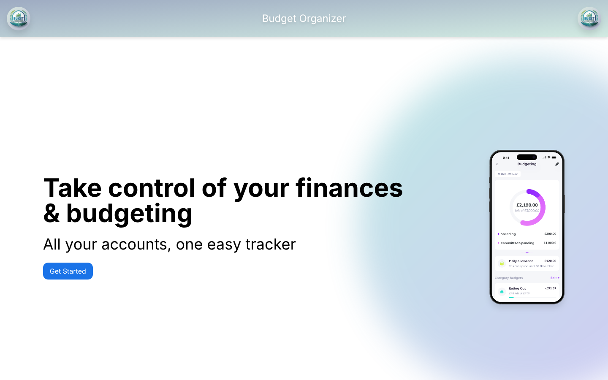

# BudgetSync

[](https://github.com/GustavoAU/budgetsync/actions/workflows/ci.yml)

A personal budget organizer built with Vue 3. You sign in with your Google account and the app will read your budget from a Google Sheet. Work in progress.



## Status

Done:

- Landing page and layout.
- Sign in with Google using the Google Identity Services token flow (OAuth 2.0).
- Protected routes: a router guard checks the session before opening the budget page and remembers where the user was going.
- Silent token refresh before the token expires, falling back to the consent screen if Google asks for it.
- Sign out that revokes the token with Google.

Next:

- Read and edit the budget from Google Sheets.
- Monthly summary by category.

## Stack

| | |
|---|---|
| UI | Vue 3 (`<script setup>`), Vue Router, Tailwind CSS 4 |
| State | Pinia (session store) |
| Auth | Google Identity Services, OAuth 2.0 token client |
| Tooling | Vite, ESLint, Prettier, Vitest |

## How it is organised

```
src/
  composables/useGoogleOAuth.js   login, logout, token refresh, user profile
  stores/useAuthStore.js          token, expiry, profile, redirect after login
  router/authGuard.js             blocks protected routes without a valid session
  views/                          home, login, budget page, access denied
```

## Run it locally

Requires Node 22, pnpm and a Google OAuth client ID (Google Cloud Console, type "Web application", with `http://localhost:5173` as an authorized JavaScript origin).

```sh
pnpm install
cp .env.example .env   # then fill in VITE_GOOGLE_CLIENT_ID
pnpm dev
```

## Tests and checks

```sh
pnpm test          # unit tests in watch mode
pnpm lint:check
pnpm format:check
```

GitHub Actions runs lint, format, unit tests and a production build on every pull request.
